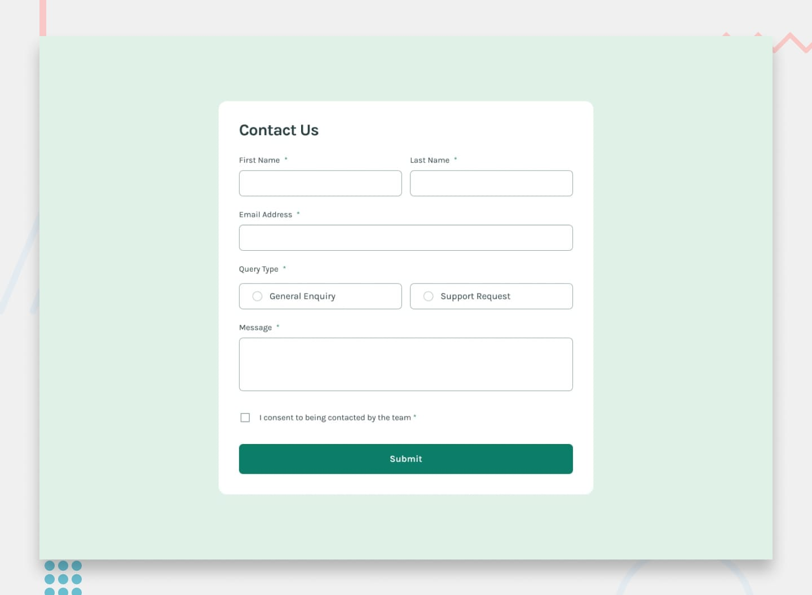

# Frontend Mentor - Contact Form Solution

This is my solution to the [Contact Form challenge](https://www.frontendmentor.io/challenges/contact-form--G-hYlqKJj) on Frontend Mentor. This project helped me practice building responsive forms, handling user input, and implementing client-side form validation using HTML, CSS, and JavaScript.

## Table of Contents

- [Frontend Mentor - Contact Form Solution](#frontend-mentor---contact-form-solution)
  - [Table of Contents](#table-of-contents)
  - [Overview](#overview)
    - [The Challenge](#the-challenge)
    - [Screenshot](#screenshot)
    - [Links](#links)
  - [My Process](#my-process)
    - [Built With](#built-with)
    - [What I Learned](#what-i-learned)
    - [Continued Development](#continued-development)
    - [Useful Resources](#useful-resources)
  - [Author](#author)

## Overview

### The Challenge

Users should be able to:

- Complete the contact form and see a success message after successful submission.
- Receive validation messages when required fields are empty.
- Receive an error message when an email address is incorrectly formatted.
- Select a query type using radio buttons.
- Give consent using a checkbox.
- Navigate and complete the form using a keyboard.
- View a responsive layout on different screen sizes.
- See hover and focus states for interactive elements.

### Screenshot

### Links

- Solution URL: [solution URL](https://github.com/yoz0816/frontend-mentor-challenges/tree/main/contact-form-main)
- Live Site URL: [Live URL](https://yoz0816.github.io/frontend-mentor-challenges/contact-form-main/)

## My Process

### Built With

- Semantic HTML5
- CSS custom properties
- CSS Flexbox
- CSS Grid
- Responsive design
- Vanilla JavaScript
- DOM manipulation
- JavaScript event listeners
- Regular expressions for email validation

### What I Learned

**1. Building forms with HTML**
I learned how to structure a contact form using labels, input fields, radio buttons, textareas, and checkboxes.

**2. Responsive layouts with CSS Grid**
I practiced using CSS Grid to arrange the first and last name fields side by side on desktop and stack them vertically on smaller screens.

**3. Form validation with JavaScript**
I learned how to validate user input and check whether required fields are completed before allowing form submission.

**4. Email validation**
I practiced using regular expressions to check whether an email address follows a valid format.

**5. DOM manipulation**
I learned how to use JavaScript to add and remove CSS classes to display validation errors and update the appearance of form elements.

**6. Handling form submission**
I used `addEventListener()` and `preventDefault()` to handle form submission, validate the fields, and display a success message when all validations pass.

### Continued Development

I want to continue improving my frontend development skills by focusing on:

- Writing cleaner and more reusable JavaScript.
- Improving form accessibility and screen reader support.
- Understanding advanced CSS layouts and responsive design.
- Learning more about JavaScript validation techniques.
- Exploring backend integration and form data handling.

### Useful Resources

- [MDN Web Docs - HTML Forms](https://developer.mozilla.org/en-US/docs/Learn_web_development/Extensions/Forms) - Helped me understand HTML form elements and form structure.
- [MDN Web Docs - CSS Grid](https://developer.mozilla.org/en-US/docs/Web/CSS/CSS_grid_layout) - Helped me understand CSS Grid layouts.
- [MDN Web Docs - JavaScript](https://developer.mozilla.org/en-US/docs/Web/JavaScript) - Useful reference for JavaScript fundamentals and DOM manipulation.
- [Google Fonts - Karla](https://fonts.google.com/specimen/Karla) - Used for the typography.

## Author

- GitHub - [@yoz0816](https://github.com/yoz0816)
- Frontend Mentor - [My Frontend Mentor Profile](https://www.frontendmentor.io/profile/yoz0816)

