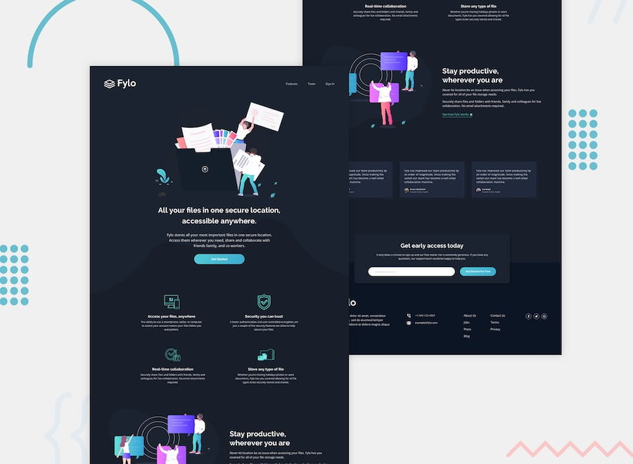

# Frontend Mentor - Fylo Dark Theme Landing Page Solution

This is my solution to the [Fylo Dark Theme Landing Page Challenge](https://www.frontendmentor.io/challenges/fylo-dark-theme-landing-page-5ca5f2d21e82137ec91a50fd).

Frontend Mentor challenges help improve frontend development skills by building realistic projects.

## Table of Contents

- [Frontend Mentor - Fylo Dark Theme Landing Page Solution](#frontend-mentor---fylo-dark-theme-landing-page-solution)
  - [Table of Contents](#table-of-contents)
  - [Overview](#overview)
    - [The Challenge](#the-challenge)
    - [Screenshot](#screenshot)
    - [Links](#links)
  - [My Process](#my-process)
    - [Built With](#built-with)
    - [What I Learned](#what-i-learned)
    - [Continued Development](#continued-development)
    - [Useful Resources](#useful-resources)
  - [Author](#author)
  - [Acknowledgments](#acknowledgments)

## Overview

### The Challenge

Users should be able to:

- View the optimal layout depending on their device's screen size.
- See hover states for all interactive elements.
- Navigate through the landing page.
- Enter an email address in the early access signup form.
- Experience a responsive layout on desktop, tablet, and mobile devices.

### Screenshot

### Links

- Solution URL: [Solution URL](https://github.com/yoz0816/frontend-mentor-challenges/tree/main/fylo-dark-theme-landing-page-master)
- Live Site URL:[live URL](https://yoz0816.github.io/frontend-mentor-challenges/fylo-dark-theme-landing-page-master/)

## My Process

### Built With

- Semantic HTML5 markup
- CSS3
- CSS custom properties (variables)
- Flexbox
- CSS Grid
- Media queries
- Responsive web design
- Vanilla JavaScript
- Font Awesome icons
- Google Fonts
- Mobile-first design principles

### What I Learned

While building this project, I improved my understanding of HTML structure, CSS layouts, responsive design, and JavaScript form validation.

**1. CSS Grid**
I learned how to use CSS Grid to create a responsive two-column feature section.

**2. Flexbox**
I used Flexbox to align elements and organize content within different sections.

**3. Responsive Design**
I practiced using media queries to adjust the layout for different screen sizes.

### Continued Development

In future projects, I want to focus on:

- Improving my CSS Grid and Flexbox skills.
- Building more responsive websites.
- Improving JavaScript DOM manipulation.
- Understanding form validation and error handling.
- Improving accessibility and semantic HTML.
- Writing cleaner and more maintainable CSS.
- Connecting frontend forms to backend services.

### Useful Resources

- [MDN Web Docs](https://developer.mozilla.org/) - A useful resource for learning HTML, CSS, and JavaScript.
- [CSS-Tricks](https://css-tricks.com/) - Helpful guides for understanding CSS Grid and Flexbox.
- [Frontend Mentor](https://www.frontendmentor.io/) - A great platform for practicing frontend development through real-world design challenges.
- [Google Fonts](https://fonts.google.com/) - Used to include Raleway and Open Sans in the project.
- [Font Awesome](https://fontawesome.com/) - Used for social media icons.

## Author

- GitHub - [@yoz0816](https://github.com/yoz0816)
- Frontend Mentor - [My Frontend Mentor Profile](https://www.frontendmentor.io/)

## Acknowledgments

- [Frontend Mentor](https://www.frontendmentor.io/) for providing the challenge and design resources.
- [MDN Web Docs](https://developer.mozilla.org/) for documentation and learning resources.
- ChatGPT for development guidance and assistance throughout the project.