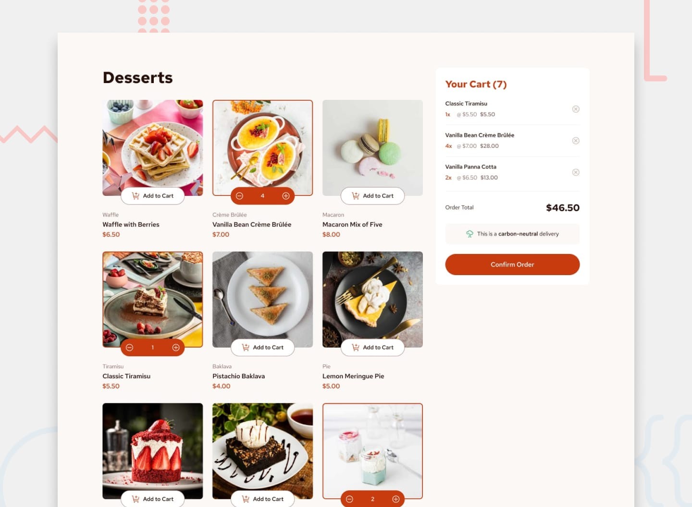

# Frontend Mentor - Product List with Cart Solution

This is my solution to the [Product List with Cart challenge](https://www.frontendmentor.io/challenges/product-list-with-cart-5MmqLVAp_d) on Frontend Mentor.

Frontend Mentor challenges help developers improve their frontend development skills by building realistic projects from design references.

## Table of Contents

- [Frontend Mentor - Product List with Cart Solution](#frontend-mentor---product-list-with-cart-solution)
  - [Table of Contents](#table-of-contents)
  - [Overview](#overview)
    - [The Challenge](#the-challenge)
    - [Screenshot](#screenshot)
    - [Links](#links)
  - [My Process](#my-process)
    - [Built With](#built-with)
  - [What I Learned](#what-i-learned)
    - [1. Rendering Products Dynamically](#1-rendering-products-dynamically)
    - [2. Managing Shopping Cart State](#2-managing-shopping-cart-state)
    - [3. Calculating the Order Total](#3-calculating-the-order-total)
    - [4. Using Event Delegation](#4-using-event-delegation)
    - [5. Creating an Order Confirmation Modal](#5-creating-an-order-confirmation-modal)
    - [6. Making the Layout Responsive](#6-making-the-layout-responsive)
    - [7. Loading Local Product Data](#7-loading-local-product-data)
  - [Continued Development](#continued-development)
  - [Useful Resources](#useful-resources)
  - [Author](#author)

## Overview

### The Challenge

The goal was to build a responsive product listing page where users can select desserts, manage their shopping cart, and confirm their orders.

Users should be able to:

- Add products to the shopping cart.
- Remove products from the cart.
- Increase or decrease product quantities.
- View the total number of items in the cart.
- See the total price update automatically.
- View an order confirmation modal after clicking "Confirm Order."
- Start a new order and reset their selections.
- View a responsive layout on desktop, tablet, and mobile devices.
- See hover and focus states for interactive elements.

### Screenshot

### Links

- **Solution URL:** [Solution URL](https://github.com/yoz0816/frontend-mentor-challenges/tree/main/product-list-with-cart-main)
- **Live Site URL:** [Live URL](https://yoz0816.github.io/frontend-mentor-challenges/product-list-with-cart-main/)

## My Process

### Built With

- Semantic HTML5
- CSS custom properties
- CSS Grid
- Flexbox
- Responsive design with CSS media queries
- Vanilla JavaScript
- JavaScript DOM manipulation
- JavaScript event listeners and event delegation
- JavaScript array methods
- HTML `<picture>` and `<source>` elements for responsive images
- Google Fonts — Red Hat Text

## What I Learned

Working on this project helped me practice JavaScript and understand how to connect HTML, CSS, and JavaScript to create an interactive website.

### 1. Rendering Products Dynamically

I learned how to use JavaScript to generate product cards from an array of product objects instead of writing every card manually in HTML.

### 2. Managing Shopping Cart State

I learned how to use arrays and objects to represent products in the cart and track their quantities.

The spread syntax allows the selected product's information to be copied into a new cart item with an additional `quantity` property.

### 3. Calculating the Order Total

I practiced using the `reduce()` method to calculate the total price of all selected products.

### 4. Using Event Delegation

Instead of attaching a separate event listener to every product button, I used event delegation to handle clicks through the product grid.

### 5. Creating an Order Confirmation Modal

I learned how to show and hide an HTML modal using JavaScript and update its content dynamically based on the products in the cart.

### 6. Making the Layout Responsive

I practiced using CSS Grid, Flexbox, and media queries to adjust the product layout and shopping cart for different screen sizes.

### 7. Loading Local Product Data

I learned how to organize product information in a separate JavaScript file and access it from the main application.

Using a JavaScript data file also allows the project to run directly in a browser without requiring a server to fetch a local JSON file.

## Continued Development

I want to continue improving my frontend development skills by focusing on:

- Writing cleaner and more maintainable JavaScript.
- Improving accessibility and keyboard navigation.
- Strengthening my understanding of DOM manipulation and event handling.
- Learning more about JavaScript modules and code organization.
- Improving responsive layouts for different screen sizes.
- Learning how to persist shopping cart data using `localStorage`.
- Practicing form validation and handling user interactions.
- Building more projects with HTML, CSS, and JavaScript before moving on to more advanced technologies.

## Useful Resources

- [Frontend Mentor](https://www.frontendmentor.io/) — A platform for practicing frontend development through realistic challenges.
- [MDN Web Docs](https://developer.mozilla.org/en-US/) — Documentation and guides for HTML, CSS, and JavaScript.
- [JavaScript.info](https://javascript.info/) — A comprehensive JavaScript tutorial.
- [W3Schools JavaScript Tutorial](https://www.w3schools.com/js/) — JavaScript lessons and examples for beginners.
- [The Markdown Guide](https://www.markdownguide.org/) — A guide to writing and formatting Markdown files.

## Author

- **Name:** Yoz
- **Frontend Mentor:** [@yourusername](https://www.frontendmentor.io/)

